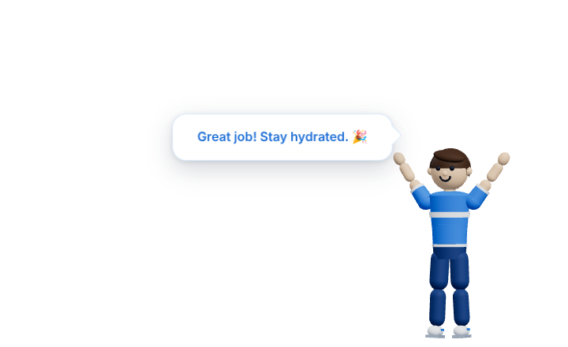
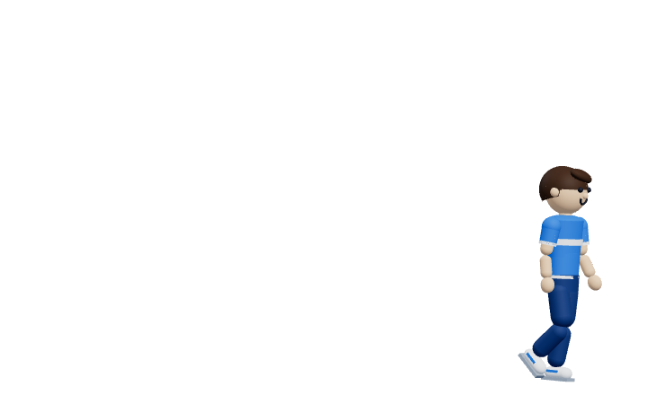

# AquaMate 💧

A small desktop prototype of a 3D hydration buddy for **Windows and macOS**.
Click **Test Reminder** and a 3D character walks onto your desktop from the
bottom-right corner, waves, and reminds you to drink water. He cheers when you
say you drank some, then walks off again.

Built with Electron, React, TypeScript, three.js and React Three Fiber.

| Reminder | "I Drank Water" | Walking away |
| --- | --- | --- |
|  |  |  |

<sub>These screenshots come from the automated test, which runs on Linux. On
Windows and macOS the white area is transparent and your desktop shows through.</sub>

## Quick start

You need Node.js 20 or newer.

```bash
npm install
```

```bash
npm run dev
```

`npm run dev` starts Vite with hot reload and opens the app. To run the
production build locally instead:

```bash
npm start
```

A small **AquaMate** control panel opens. Click **Test Reminder**:

1. The transparent overlay appears in the bottom-right corner of the screen
   you're using.
2. The character walks in from the right edge, stops and waves.
3. A card says **"Hey! Time to drink some water 💧"** with two buttons:
   - **I Drank Water**: he plays the Happy animation, the card says
     **"Great job! Stay hydrated."**, and after about 2.4 s he walks away and
     the overlay hides.
   - **Dismiss**: he walks away and the overlay hides.

Closing the control panel quits the app.

## Building installers

```bash
npm run dist:win
```

Run this on Windows. It writes an NSIS installer to `release/AquaMate-Setup-0.1.0.exe`.

```bash
npm run dist:mac
```

Run this on macOS. It writes `.dmg` files for Intel (x64) and Apple Silicon (arm64) to `release/`.

Build each installer on its own OS: electron-builder can't make a macOS DMG from
Windows, and needs extra tools to make a Windows installer from macOS or Linux.
The builds are **unsigned**:

- On Windows, SmartScreen may say "Windows protected your PC". Click
  **More info → Run anyway**.
- On macOS, right-click the app and choose **Open** the first time.

To sign the builds, set the usual electron-builder `CSC_*` and notarization
environment variables. To add custom app icons, put `icon.icns` and `icon.ico`
in a `build/` folder.

## Tests

`npm test` builds the app, launches the real Electron app with Playwright and
runs the whole reminder flow twice: once with **I Drank Water** and once with
**Dismiss**. It checks that:

- the overlay is hidden at start, then becomes visible, always on top, and
  anchored to the bottom-right of the work area
- the character moves left while the Walk clip plays, stops exactly at the
  designated position, and plays Wave, then Idle
- **I Drank Water** plays Happy, shows "Great job! Stay hydrated.", waits
  briefly, then walks right while the Walk clip plays, and hides the window
- **Dismiss** walks away and hides the window
- the control panel status updates, and no renderer errors are logged

Screenshots are saved to `test-results/`.

```bash
npm test
```

On a headless Linux machine or CI, run it under a virtual display:

```bash
xvfb-run -a npm test
```

## Project structure

```
src/
  main/
    main.ts              app lifecycle, app:// protocol, IPC
    window-manager.ts    control panel + transparent mascot overlay
    preload.ts           safe IPC bridge (contextIsolation + sandbox)
  renderer/
    App.tsx              view switch, reminder state machine, control panel
    Mascot.tsx           GLB loading, walk in/out movement, facing
    ReminderCard.tsx     floating speech-bubble card
    AnimationController.ts  AnimationMixer wrapper (cross-fades, one-shots, clip aliases)
    styles.css           card, button and panel styles + CSS animations
    index.html, main.tsx, env.d.ts
assets/
  models/
    human-character.glb  placeholder rigged character (see assets/models/README.md)
scripts/
  dev.mjs                         dev runner (tsc + Vite + Electron)
  generate-placeholder-model.mjs  builds the placeholder GLB
tests/
  e2e.mjs                         Playwright end-to-end test
```

## How it works

**Smooth movement without flicker.** The overlay is a fixed 720 × 440
transparent window anchored to the bottom-right of the work area, so it sits
above the taskbar or Dock. It is positioned once, while it is still hidden, and
never moves while it is visible. The character walks *inside* it. This avoids the
jitter and tearing you get from calling `setBounds()` on every frame, which is
especially noticeable on Windows.

**Showing and hiding.** The renderer resets the character off-stage first and
only then asks the main process to show the window, which uses `showInactive()`
so it never steals focus. After the exit, it waits for an empty frame to be
painted before hiding the window. A stale frame can't flash on the next show.

**Synced animation.** Movement is advanced in `useFrame` using the frame
delta. Ground speed is `WALK_STRIDE_SPEED × timeScale` of the Walk clip, so the
feet match the stride. The delta is capped, so a stalled frame never teleports
the character. Turning is smoothed with exponential damping.

**Click-through.** On Windows and macOS the overlay ignores mouse events
(`setIgnoreMouseEvents(true, { forward: true })`) except while the pointer is
over the card. Your desktop stays usable even when the character is on screen.

**Always on top.** The overlay uses the `screen-saver` level, is visible on all
workspaces and over full-screen apps, skips the taskbar and has no shadow.

**Lightweight.**
- The renderer is a single Vite bundle, with no runtime `node_modules` in the
  installer.
- The model is about 0.5 MB.
- WebGL uses the `low-power` GPU preference, and Chromium throttles the
  overlay while it is hidden.

**Resilient.** If WebGL isn't available or the model fails to load, the
reminder still works with the card only.

**Secure defaults.**
- `contextIsolation`, `sandbox` and no `nodeIntegration` are on.
- A strict CSP is set on the packaged renderer.
- Navigation and `window.open` are blocked.
- Packaged files are served from a custom `app://` protocol with a
  path-traversal guard.

## The 3D character

> ⚠️ **Missing production asset.** No suitably licensed GLB of a stylized man
> in a blue-and-white outfit with Idle, Walk, Wave and Happy clips was
> available, so `assets/models/human-character.glb` is a **replaceable
> placeholder**.

The placeholder is a real rigged model: an 18-bone skeleton, skinned meshes and
four clips. It is generated by `scripts/generate-placeholder-model.mjs`. You
can swap in a production model without code changes: the loader rescales and
grounds any model, and the animation controller maps common clip names such as
`Walking`, `Cheering` and `mixamo.com|Wave`. The full asset spec and the
replacement steps are in [`assets/models/README.md`](assets/models/README.md).

## Scope and known limitations

This is a prototype. It only shows a reminder when you click **Test Reminder**:
there is no scheduler, history, settings, database, accounts, analytics or
backend.

- The automated test runs on Linux with software WebGL. The Windows (NSIS) and
  macOS (DMG) build settings are included, but the installers haven't been built
  or tested on real Windows or macOS machines yet.
- On Linux, click-through isn't supported (Electron can't forward mouse moves
  there), so the overlay area stays clickable while it is visible.
- The installers are unsigned (see [Building installers](#building-installers)).

## License and credits

MIT, see [LICENSE](LICENSE). Some desktop-window techniques are adapted from
[sharada-dev/hydrate-buddy](https://github.com/sharada-dev/hydrate-buddy)
(MIT). Its license and a list of what was reused are in
[THIRD_PARTY_NOTICES.md](THIRD_PARTY_NOTICES.md).
