# AquaMate 💧

A 3D companion for **Windows, macOS and Android** that reminds you to drink
water. When it's time, a character walks onto your screen carrying a water
bottle and waves at you. Tell him you drank water and he drinks with you and
cheers. Pick **Drink Later** and he sighs and trudges sadly across your whole
screen, or back the way he came if you prefer.

Built with Electron (desktop), Capacitor (Android), React, TypeScript, three.js
and React Three Fiber. Both apps share the same characters, animations,
reminder rules and screens.

| Reminder | "I Drank Water" | Celebration |
| --- | --- | --- |
| 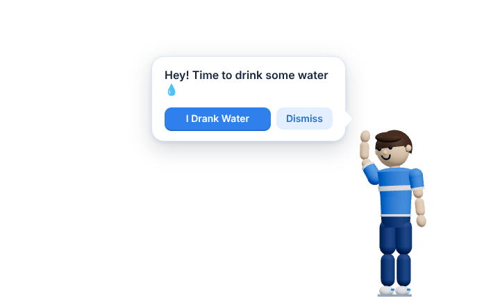 | 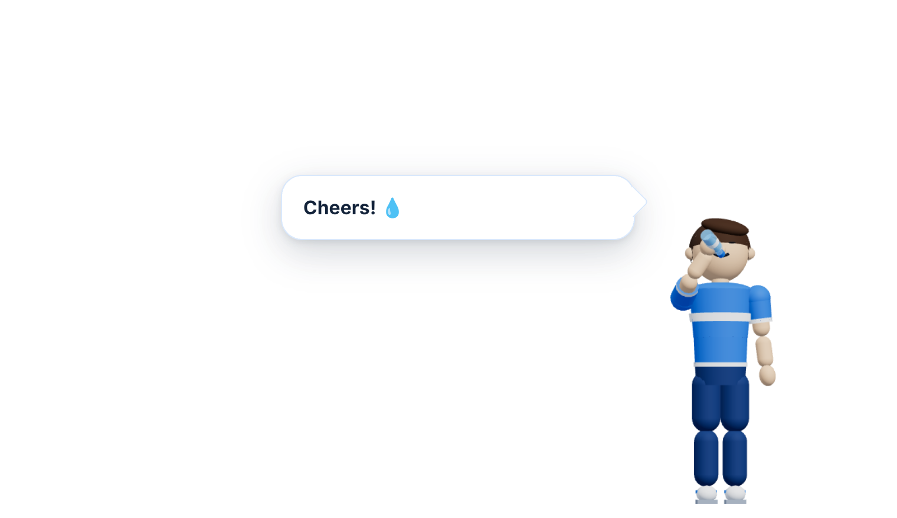 | 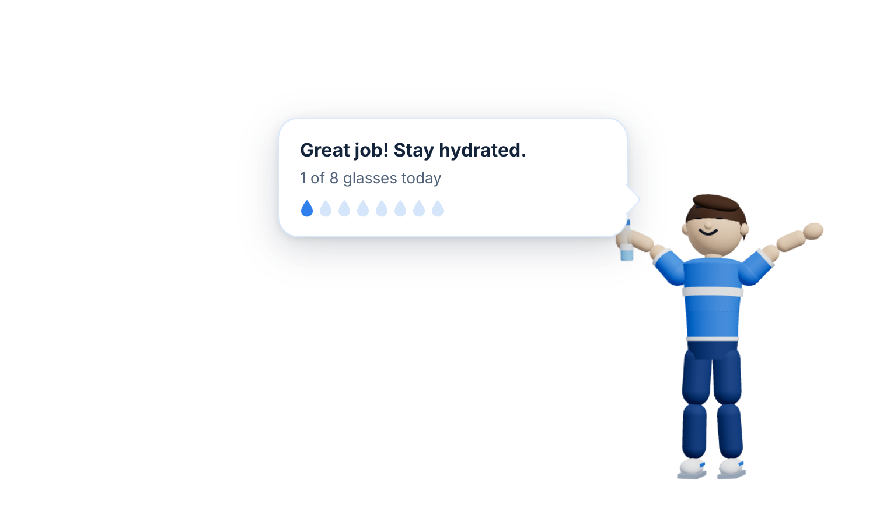 |

| "Drink Later": a sad walk across the screen |
| --- |
| 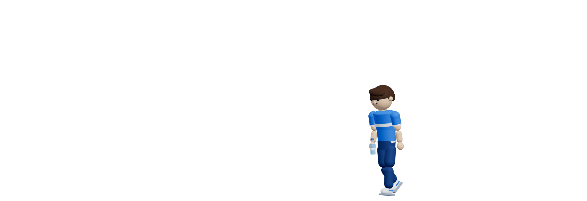 |

| Settings | Character creator | Your own characters |
| --- | --- | --- |
| 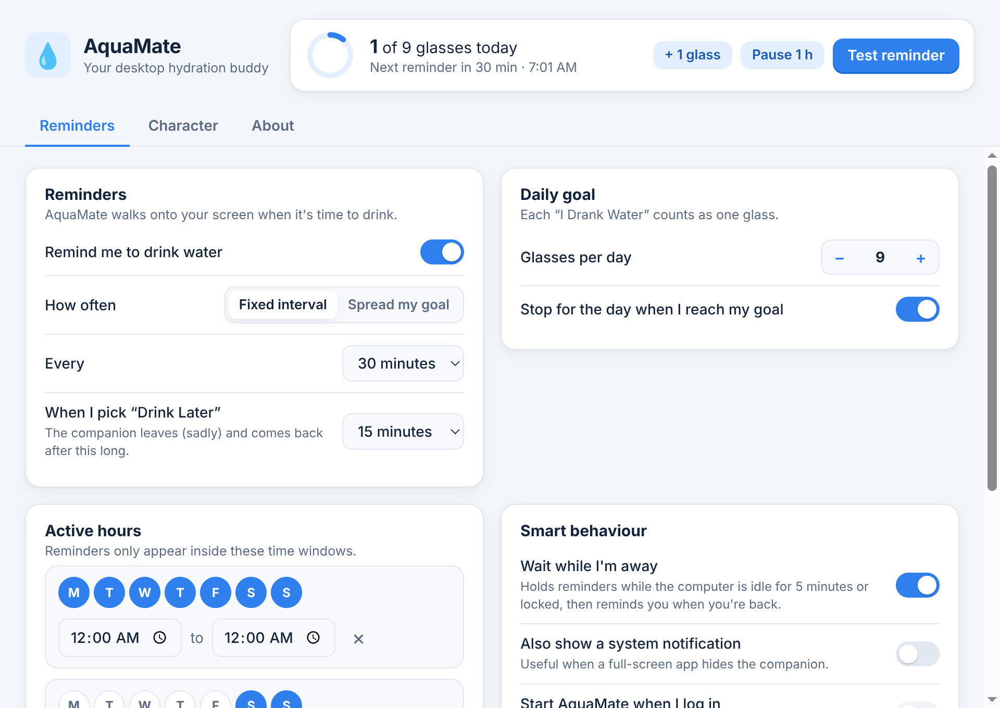 | 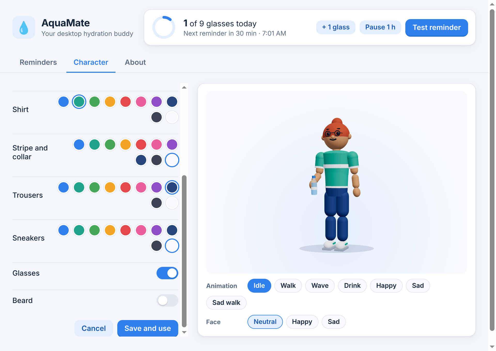 | 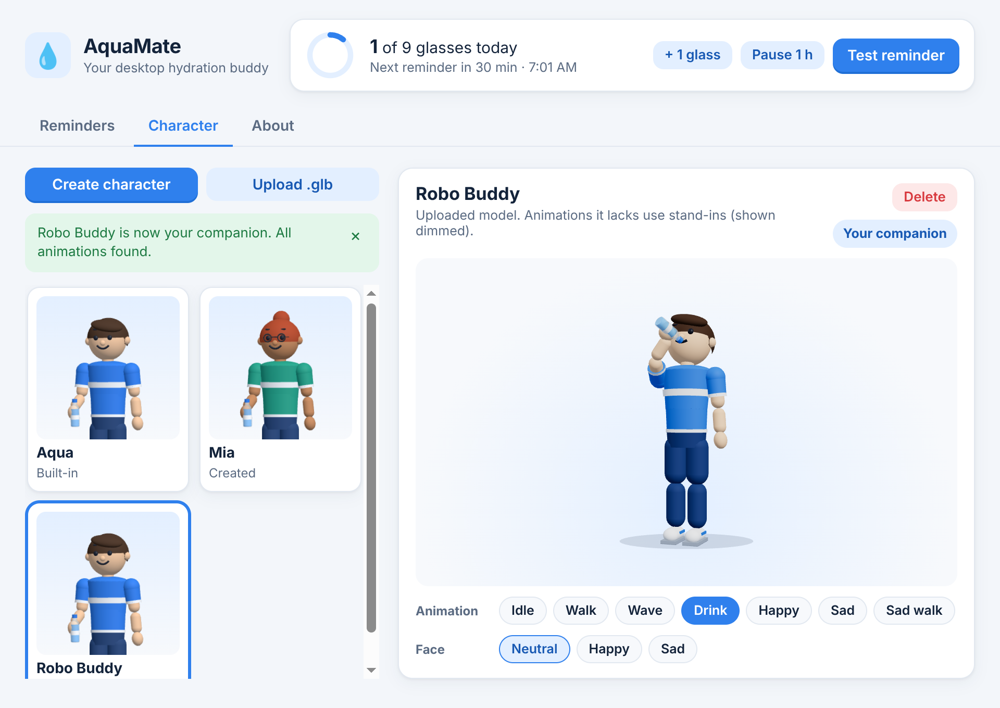 |

<sub>Screenshots come from the automated tests, which run on Linux. On Windows
and macOS the white area around the character is transparent, so your desktop
shows through.</sub>

## Features

**Engaging companion**

- His hands are free by default: what he carries shows what a reminder is
  for. A water reminder walks in carrying a water bottle. **I Drank Water**
  makes him lift it to his mouth and drink, eyes closed, as the water level
  drops. Then he cheers. (Medicine and other reminder types are planned.)
- **Drink Later** makes him sigh, shake his head and walk slowly away with a
  sad face.
- You choose how he leaves, whether you drank or not: **across the whole
  screen** or **back the way he came**, at a **walk** or a **run**.
- His face has happy, sad and "joyful" expressions, and he blinks naturally.
- The reminder card speaks to you by name, greets you in the morning, says
  "Ready now?" after a snooze, and shows today's glasses as water drops.
- A small **×** skips a reminder without fuss.
- **Relax mode** 🌿: turn it on from the menu bar or system tray, or with
  **Relax** in the settings window. Your companion walks to the middle of the
  screen with empty hands, sits down cross-legged, closes their eyes with a faint smile and
  breathes slowly (about one breath every 5½ seconds), head resting gently
  to one side. After a few minutes (**Doze off**: never, 1, 3, 5 or 10) they
  nod off: deeper, slower breaths, head sinking forward, an occasional little
  nod, and a floating "z z z". Turn it off (or let **Relax for** 15, 30 or 60
  minutes run out) and they open their eyes (a big seated stretch and a yawn
  if they were asleep), stand up, wave and leave the way you chose.
  Scheduled water reminders wait until you're done relaxing; **Remind me now**
  still gets them up to remind you.

**Smart reminders**

- **Fixed interval** (every 15 minutes to 3 hours), or **Spread my goal**: the
  time left today is divided by the glasses you still need, so you get more
  reminders when you're behind and fewer when you're ahead.
- A **daily goal**, with an option to stop reminding once you reach it.
- **Active hours**: one or more time windows, each with its own days. Windows
  can run past midnight, for example 22:00–06:00 for night shifts.
- **Drink Later**: the snooze length.
- **When he leaves**: one setting for every exit (after drinking, Drink
  Later, × or no answer). **Where he goes**: across the screen (default) or
  back the way he came. **Pace**: walk (default) or run.
- **Wait while I'm away**: no reminders while the computer is idle or locked.
  When you come back you get one reminder, not a backlog. Works after sleep and
  wake too.
- An optional system notification, for when a full-screen app hides the
  companion.
- AquaMate lives in the **menu bar (macOS) or system tray (Windows)**, with
  *Remind me now*, *I drank a glass*, *Relax mode*, *Pause for 1 hour*, *Pause until
  tomorrow* and *Settings…*. Closing the settings window keeps it running.
- **Start at login** (installed app).

**Characters**

- Two built-in companions: **Aqua** (male, the default) and **Marina**
  (female). Pick either in **Settings → Character**.
- A **character creator**: name, body (male or female), skin tone, five
  hairstyles, hair color, shirt, stripe, trousers, sneakers, glasses and beard
  (male only), with a live 3D preview. Picking a body also picks a matching
  hairstyle, which you can still change. A female body has a narrower waist,
  fuller hips, eyelashes and rosy cheeks, so it reads as female with any
  hairstyle. Both bodies share one skeleton, so every animation (drinking,
  walking, running) works the same.
- **Upload your own rigged `.glb`**. Clip names such as `Walking`, `Cheering`
  or `mixamo.com|Wave` are recognized, missing animations use stand-ins, and
  the bottle goes into the model's right hand automatically.
- A gallery with thumbnails, a live preview of every animation and expression
  (drag to turn), edit, delete, and *Use as companion*.

## Android

The Android app has the same companion, animations, expressions, character
creator and reminder rules:

- Reminders arrive as **notifications with "I drank water" and "Drink later"
  buttons**, even when the app is closed. Tapping one opens the animated scene.
- The character lives on a **Today** screen, where he drinks along when you log
  a glass. **Relax** sits him down right there; tap him (or **Wake up**) to
  get him up. Logging a glass while he relaxes gets him up to drink along.

| Today | Reminder | Drink Later | Character |
| --- | --- | --- | --- |
| 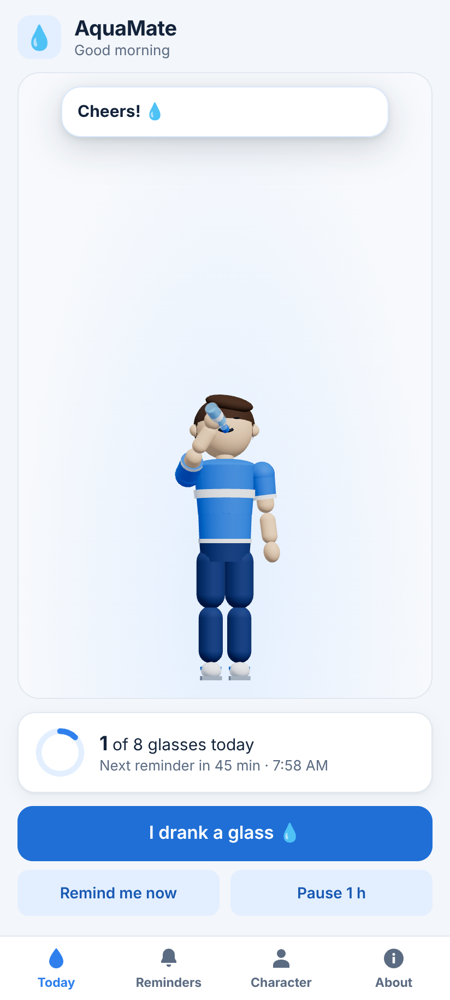 | 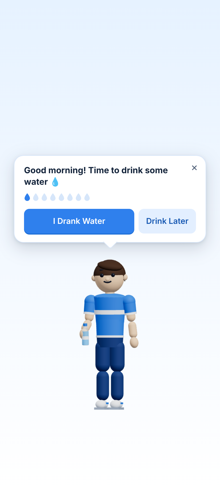 | 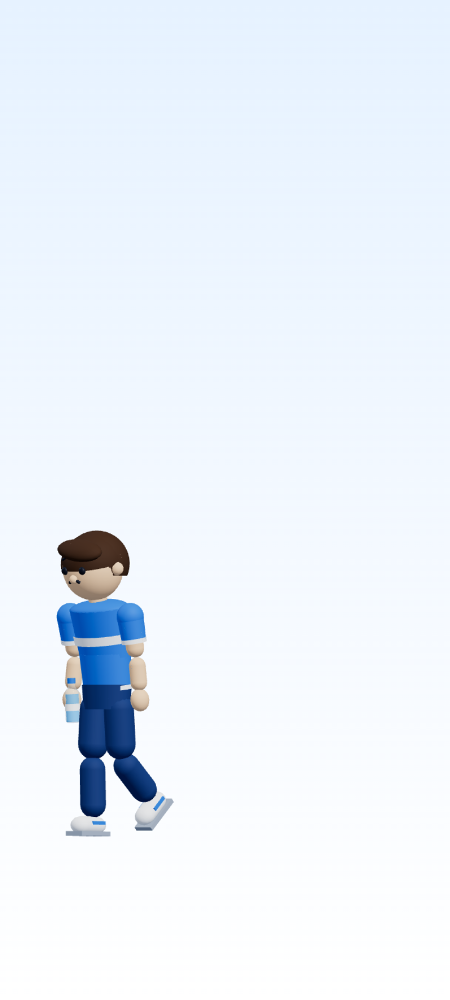 | 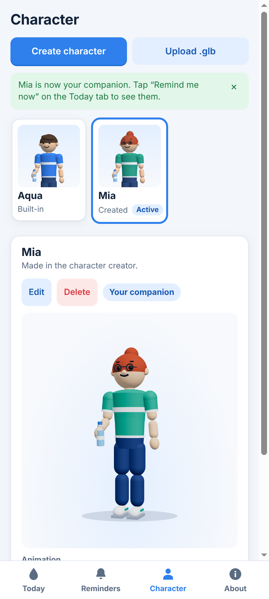 |

The quickest way to try it is the APK that GitHub builds on every push: go to
**Actions → Android APK** and download **AquaMate-debug-apk**. To build it
yourself (needs Android Studio):

```bash
npm run android:apk
```

The full guide is in [docs/ANDROID.md](docs/ANDROID.md): building, installing,
how notifications and scheduling work, and releasing to Google Play.

## Quick start

You need Node.js 22 or newer (20.19+ also works). Step-by-step Mac
instructions are in [Try it on a Mac](#try-it-on-a-mac).

```bash
npm install
```

```bash
npm run dev
```

`npm run dev` starts Vite with hot reload and opens the app. To run the
production build locally instead:

```bash
npm start
```

The **AquaMate** settings window opens. Click **Test reminder** and watch the
bottom-right corner of your screen.

## Try it on a Mac

### 1. Install the tools (one time)

- **Node.js:** download the **LTS** installer from https://nodejs.org and run it.
- **Git:** run `git --version` in Terminal. If Git isn't installed, macOS offers
  to install the Command Line Tools; click **Install**. If you'd rather skip
  Git, use the ZIP download in step 2.

Check that Node works:

```bash
node -v
```

### 2. Get the code

```bash
git clone https://github.com/tumatikiran/waterintake.git
```

```bash
cd waterintake
```

No Git? Download https://github.com/tumatikiran/waterintake/archive/refs/heads/main.zip,
double-click it to unzip, then `cd` into the `waterintake-main` folder in Terminal.

If you already cloned an earlier version, update it instead:

```bash
git pull
```

### 3. Test it without installing anything

```bash
npm install
```

```bash
npm start
```

The **AquaMate** settings window opens. Click **Test reminder** and watch the
bottom-right corner of your screen, just above the Dock. Closing the window
keeps AquaMate running in the menu bar (the water-drop icon). Quit from that
icon's menu or with **⌘Q**. While you run it this way, the menu bar says
"Electron"; the installed app from step 4 says "AquaMate".

You can also run the automated tests. They drive the app on your screen for
about a minute and use a separate, throwaway data folder, so your own
settings aren't touched:

```bash
npm test
```

### 4. Build and install the app

```bash
npm run dist:mac
```

This creates a DMG for your Mac's chip in the `release/` folder:

- `AquaMate-0.1.0-arm64.dmg` on Apple Silicon (M1 and newer)
- `AquaMate-0.1.0-x64.dmg` on Intel Macs

Open the DMG, drag **AquaMate** into **Applications**, then open it from
Launchpad or the Applications folder.

The app is ad-hoc signed, not signed with an Apple Developer ID. A DMG you
build on your own Mac opens normally. If you copy it to another Mac or
download it, macOS says it can't verify the app. To open it anyway:

1. Try to open AquaMate once and close the warning.
2. Go to **System Settings → Privacy & Security**.
3. Scroll down, click **Open Anyway** next to the AquaMate message, and confirm.

To uninstall, quit AquaMate from its menu-bar icon and drag it from
**Applications** to the Trash.

## Building installers

```bash
npm run dist:win
```

Run this on Windows. It writes an NSIS installer to `release/AquaMate-Setup-0.1.0.exe`.

```bash
npm run dist:mac
```

Run this on macOS. It writes a `.dmg` for the Mac you're building on to
`release/`, for example `AquaMate-0.1.0-arm64.dmg`. To build both Intel and
Apple Silicon DMGs:

```bash
npm run dist:mac -- --x64 --arm64
```

Build each installer on its own OS: electron-builder can't make a macOS DMG from
Windows, and needs extra tools to make a Windows installer from macOS or Linux.
The app icon is `build/icon.png`; electron-builder converts it to `.icns` and
`.ico`. Neither installer is signed with a developer certificate:

- On Windows, SmartScreen may say "Windows protected your PC". Click
  **More info → Run anyway**.
- On macOS, the app is ad-hoc signed (`"identity": "-"` in `package.json`) so it
  runs on Apple Silicon. A copy downloaded from elsewhere needs
  **System Settings → Privacy & Security → Open Anyway** the first time.

For real distribution, sign with a Developer ID: replace `"identity": "-"` with
your certificate name, turn `hardenedRuntime` back on and set up notarization.

## Tests

```bash
npm test
```

This builds both apps, then runs three kinds of tests:

- **Unit tests** (`tests/unit/`) for the scheduling rules:
  - time windows, including overnight and all-day ones
  - skipped days
  - the goal-spread interval and its limits
  - snooze, pause and resume
  - stopping once the goal is reached
  - cleaning up settings from older or hand-edited files
  - the reminder list: upgrading older settings, the built-in water
    reminder, per-reminder updates, and the per-reminder daily log
  - the multi-reminder scheduler: one next time per reminder, reminders due
    together shown one at a time, and a waiting reminder not holding up others
  - the companion's state machine (`src/shared/companion.ts`): every move
    between reminding, relaxing, sleeping and waking, on the desktop and on
    Android's Today screen
- **End-to-end tests** (`tests/e2e.mjs`), which launch the real Electron app
  with Playwright, using a throwaway data folder:
  - **Reminder appears:** the full-width overlay shows, stays on top, and the
    character walks in, stops at his mark and waves.
  - **I Drank Water:** he drinks with his eyes closed, the bottle's water
    level drops, he celebrates, the glass is counted, and he walks off
    across the screen. With **Where he goes: Back the way he came** and
    **Pace: Run**, he runs back to the right, faster than he walks.
  - **Drink Later:** he sighs with a sad face, walks across the whole screen
    to the left, and the next reminder is set about 15 minutes later. With
    **Where he goes: Back the way he came**, he walks back to the right
    instead, still sad.
  - **× (skip):** he leaves the same way as Drink Later, without counting a
    glass.
  - **Settings:** changes save to `settings.json` straight away.
  - **Character creator:** saves a character (with a female body) with a
    thumbnail, and that character appears in the next reminder.
  - **`.glb` upload:** valid files are added and selected, a fake file is
    refused, and deleting the active character falls back to the default.
  - **Marina and Aqua:** each built-in can be chosen (built-ins can't be
    deleted) and is the one on stage throughout every interaction: walking
    in, waiting, drinking, Drink Later, × and leaving. The Android suite
    checks the same on the Today screen and in the reminder scene.
  - **Dozing:** Relax mode dozes off (asleep face, "zzz"), a reminder wakes
    the sleeping companion with a stretch and a yawn, turning Relax mode off
    while asleep does the same before leaving, and **Relax for** ends it by
    itself.
  - **Relax mode:** for Marina and for Aqua, the companion walks to the exact
    middle of the screen, sits down, relaxes with closed eyes until it is
    turned off, then stands up and leaves, and the overlay hides. A reminder
    during Relax mode gets them up, they walk over to the card, and Relax
    mode ends. The Android suite checks Relax on the Today screen, coming
    back to it while relaxing, tap to wake, and logging a glass while relaxing.
  - **No errors:** the renderer logs no errors.
- **Android UI tests** (`tests/mobile-e2e.mjs`), which run the phone app in a
  phone-sized window and cover scheduled notifications, notification buttons,
  the reminder scene, the Today screen, settings, characters and restarts.
  `npm run test:mobile` runs just these. See [docs/ANDROID.md](docs/ANDROID.md#tests).

On a headless Linux machine or CI, run the tests under a virtual display:

```bash
xvfb-run -a npm test
```

To test a packaged build, point `AQUAMATE_EXECUTABLE` at it, for example
`release/linux-unpacked/aquamate`. Screenshots are saved to `test-results/`.

## Custom characters

Open **Settings → Character**:

- **Aqua** and **Marina** are built in. Select one and choose **Use as
  companion**.
- **Create character** opens the creator, with a live 3D preview. **Save and
  use** turns your design into a standard rigged `.glb` stored on your
  computer. You can edit it later.
- **Upload .glb** adds any rigged glTF 2.0 binary model (up to 30 MB). AquaMate
  checks that the file is valid and that three.js can load it, then renders a
  thumbnail and tells you which animations it found.

What makes an uploaded model work well:

| | |
| --- | --- |
| Format | Binary glTF 2.0 (`.glb`), textures embedded, **no Draco/KTX2 compression** |
| Orientation | Y up, facing +Z (the glTF convention), any size: it's scaled to fit |
| Rig | A skinned mesh. A right-hand bone (`RightHand`, `Hand_R`, `mixamorig:RightHand`…) gets the bottle |
| Animations | `Idle`, `Walk`, `Wave`, `Drink`, `Happy`, `Sad`, `SadWalk`, `Run`, `SitDown`, `Relax` (seated, looping), `StandUp`, or common variants such as `Walking`, `Running`, `Cheering`, `Waving` and `Sitting`. Missing ones fall back (Drink → Happy, SadWalk → a slower Walk, Run → a faster Walk, the Relax ones → Idle, so the model relaxes standing up, …) |
| Expressions | Optional morph targets: `happy`/`sad`/`blink`, ARKit-style (`mouthSmileLeft`, `mouthFrownLeft`, `browInnerUp`, `eyeBlinkLeft`…) or VRoid (`Fcl_ALL_Joy`…) |

More detail, including the metadata AquaMate's own models carry, is in
[`assets/models/README.md`](assets/models/README.md).

## How it works

```
src/
  shared/      shared by desktop and Android: the window.aquamate API contract,
               types, settings validation, scheduling rules, character-library
               rules, today's count (unit-tested)
  main/        Electron main process
    main.ts             app lifecycle, IPC (checks which window sent each message), app:// protocol
    window-manager.ts   settings window + transparent overlay, click-through
    scheduler.ts        smart reminder timer (idle-aware, survives sleep)
    stores.ts           JSON files for settings and today's count
    character-store.ts  custom characters on disk (validated .glb + index)
    tray.ts             menu-bar / system-tray menu
    preload.ts          the safe window.aquamate API
  renderer/
    Overlay.tsx         reminder flow on the overlay
    Mascot.tsx          the character on stage (the "actor")
    ReminderCard.tsx    speech-bubble card with progress drops
    AnimationController.ts  plays animation roles, with fallbacks
    behavior/           interactions.ts (scripts as data), Director.ts, messages.ts
    character/          procedural.ts (rig, face, clips), rig.ts, registry.ts,
                        ExpressionController.ts, WaterBottle.ts, assets.ts, snapshot.ts
    settings/           settings window: reminders, characters, creator
    mobile/             Android: bridge.ts (Capacitor storage + notifications),
                        MobileApp.tsx (tabs, Today screen, reminder scene)
android/       the native Android project (Capacitor)
assets/models/human-character.glb          Aqua, the default companion (generated)
assets/models/human-character-female.glb   Marina (generated)
scripts/       generate-placeholder-model.mjs, generate-icons.mjs, dev.mjs, android-apk.mjs
tests/         unit/, e2e.mjs (desktop), mobile-e2e.mjs + mobile-host.cjs (Android UI)
```

- **Reminders are a list of typed reminders.** Water is built in; each type
  (`src/shared/reminders.ts`) says how it's scheduled, what the companion
  carries and how it's worded, so new kinds of reminders slot in without
  changing the rest.
- **Reminders run in the main process.** `scheduler.ts` keeps one next time
  per reminder and checks the clock every 15 seconds instead of setting one
  long timer, so reminders survive sleep and clock changes. Two due together
  are shown one after the other. All the rules are pure functions in
  `src/shared/schedule.ts`.
- **The overlay is a full-width transparent strip** along the bottom of the
  screen. It's positioned while hidden and never moves while visible; the
  character walks inside it. The card is the only clickable area: the main
  process checks the cursor against the card, which works even though the
  overlay never takes focus.
- **Behaviour is data.** Each interaction (`arrive`, `drank`, `later`,
  `skip`, `timeout`, `relax`, `wake`, `doze`, …) is a list of steps such as
  walk, face, play, loop, prop, expression, say and wait. A pure state machine
  (`src/shared/companion.ts`) decides which to play; `Director` runs the
  steps, and `Mascot` carries them out in time with rendering. Walking speed
  matches each walk animation's stride, so the feet don't slide.
- **Characters share one pipeline.**
  - The default, created and uploaded characters are all `.glb` files, turned
    into a `CharacterRig`: scaled to a common height, with animation roles, an
    expression controller and a hand that holds props (the water bottle during
    water reminders).
  - The default and created characters come from `procedural.ts`, which bakes
    empty-handed clips with feet on the ground, plus a right-arm carry pose
    used while holding something; while drinking an IK solve brings the
    bottle's cap to the mouth.
- **Secure defaults:**
  - Context isolation, sandboxed renderers and no Node integration.
  - A strict CSP on the packaged renderer.
  - Navigation and pop-up windows are blocked.
  - Every IPC message is checked for the window it came from and validated.
  - Stored files only ever use IDs the app generated itself.

Adding your own animations, expressions, interactions or reminder rules is
described in [`docs/ARCHITECTURE.md`](docs/ARCHITECTURE.md).

## Your data

Everything stays on your computer, in AquaMate's data folder. **Settings →
About** shows the exact path; it's under `~/Library/Application Support` on
macOS and `%APPDATA%` on Windows.

| File | Contents |
| --- | --- |
| `settings.json` | Your settings and reminders (files from older versions are upgraded automatically) |
| `today.json` | Today's log per reminder (glasses so far), which resets at midnight; there's no long-term history |
| `characters/` | Your created and uploaded characters |

## Scope and known limitations

- The automated tests run on Linux with software WebGL. The Windows (NSIS) and
  macOS (DMG) builds are configured but haven't been built or tested on real
  Windows or macOS machines.
- The Android UI and logic are tested in a phone-sized window with Capacitor's
  browser fallbacks. The APK is built by GitHub Actions, but it hasn't been run
  on a physical phone yet, so check the native parts there: notification
  buttons, delivery timing and the file picker.
- On Android, reminders can arrive a few minutes late (Android batches
  alarms to save battery), and the companion appears inside the app rather
  than over other apps.
- By default he leaves by walking across the full screen width, which takes
  10–20 seconds on a wide monitor. The overlay is click-through, so it doesn't
  get in your way. For a short exit, set **Where he goes** to **Back the way
  he came**, or **Pace** to **Run**.
- For uploaded models, the bottle is placed by a best guess at the right hand,
  and only models with their own `Drink` clip lift it to the mouth.
- On macOS, the overlay may not appear on top of apps in full-screen mode; turn
  on the system notification option for those cases.
- On Linux, click-through is off, so the overlay area is clickable while it's
  visible.
- Only today's count is stored: there are no accounts, sync, history or
  analytics.
- The installers aren't signed with a developer certificate (see
  [Building installers](#building-installers)).

## License and credits

MIT, see [LICENSE](LICENSE). Some desktop-window techniques are adapted from
[sharada-dev/hydrate-buddy](https://github.com/sharada-dev/hydrate-buddy)
(MIT). Its license and a list of what was reused are in
[THIRD_PARTY_NOTICES.md](THIRD_PARTY_NOTICES.md).
