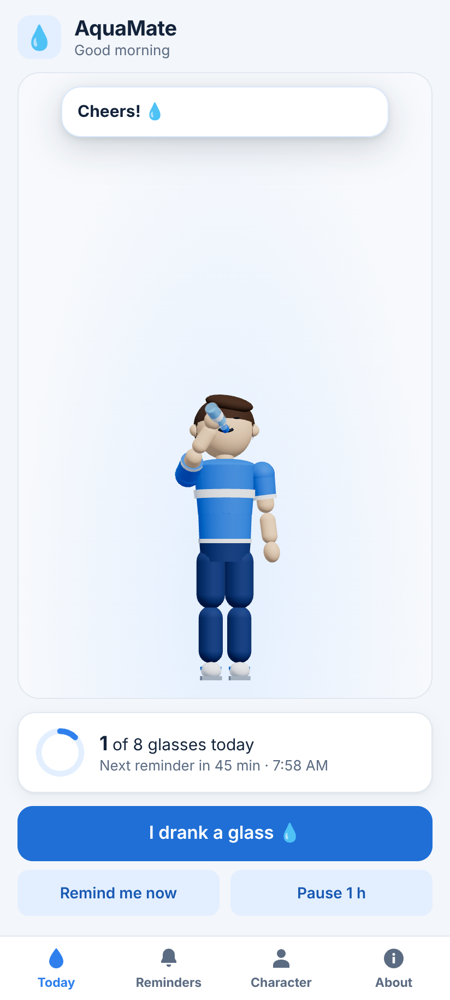
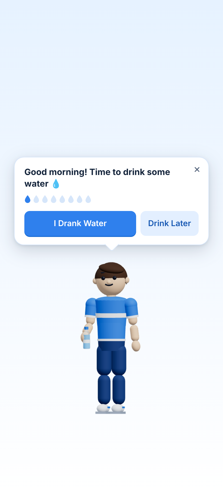
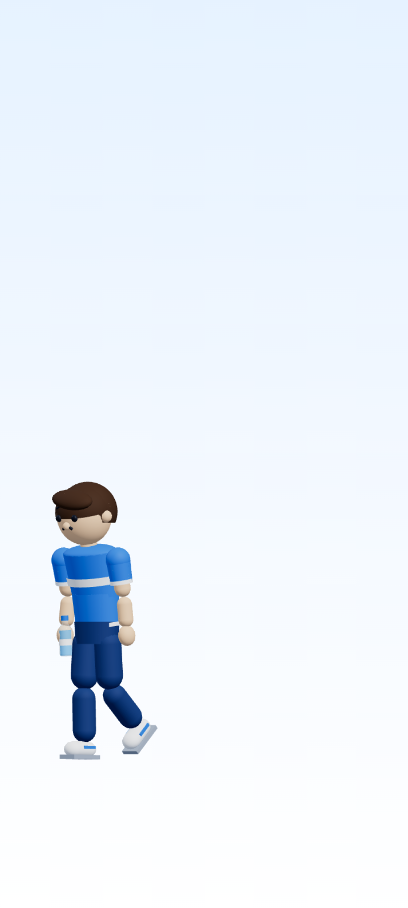
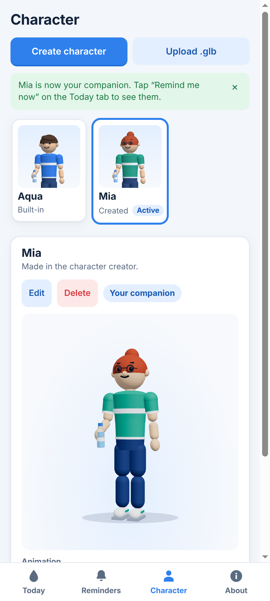

# AquaMate for Android

The Android app has the same companion, animations, expressions, character
creator, `.glb` upload and smart reminder rules as the desktop app, with the
same look. It's built from the same React + three.js code with
[Capacitor](https://capacitorjs.com), which runs that code inside a native
Android app.

| Today | Reminder | Drink Later | Character |
| --- | --- | --- | --- |
|  |  |  |  |

## How it differs from the desktop app

| | Desktop | Android |
| --- | --- | --- |
| Reminder appears as | The character walks onto your desktop over other apps | A notification with **I drank water** and **Drink later** buttons. Tapping it (or a button) opens the animated scene |
| Character between reminders | Hidden | Lives on the **Today** screen: tap him to say hi, and he drinks along when you tap **I drank a glass** |
| Runs in the background | A menu-bar / tray app | Nothing runs; the next 8 reminders are scheduled with Android ahead of time, and still fire after a reboot |
| Wait while you're away | Uses idle detection | Not needed: notifications simply wait in the shade |
| Upload `.glb` | File dialog | Android file picker |

Android can't freely draw a character on top of other apps the way the desktop
overlay does; that needs a special "display over other apps" permission and a
background service. Notifications plus the in-app scene give the same
experience without that.

## How reminders work on Android

- The same rules as on desktop (`src/shared/schedule.ts`) plan the **next 8
  reminders**, which are handed to Android as scheduled notifications.
- The plan is redone whenever something happens: you log a glass, snooze,
  skip, change a setting, or open the app.
- When you open the app, the next reminder stays where it is, so opening the
  app doesn't keep pushing reminders later.
- **Notification buttons:** tapping **I drank water** opens the scene, he
  walks in and drinks, and the glass is counted. **Drink later** plays the sad
  walk and snoozes.
- If a reminder comes due while the app is open, the scene plays right away,
  like on desktop.
- **Timing:** Android may deliver a reminder a few minutes late to save
  battery. Exact alarms would need a permission that Google Play only allows
  for alarm-clock apps.
- **Permission:** Android 13 and later ask for notification permission. The
  Today screen and the Reminders tab show an **Allow** button until you grant
  it.

## Build and install

### Get an APK without installing anything

Every push to `main` builds a debug APK on GitHub (`.github/workflows/android.yml`):

1. On GitHub, open **Actions → Android APK** and pick the latest successful run.
2. Download **AquaMate-debug-apk** under **Artifacts**. It's a zip containing
   `app-debug.apk`.
3. Copy `app-debug.apk` to your phone and open it. Android asks you to allow
   installing apps from that source, such as Files or Chrome, the first time.

### Build it yourself

You need Node.js 22+, **Android Studio**, which includes the Android SDK and a
suitable JDK, and, on macOS/Linux, `JAVA_HOME` pointing at a JDK 21.

```bash
npm install
```

```bash
npm run android:apk
```

That builds the web app, copies it into `android/` and writes
`android/app/build/outputs/apk/debug/app-debug.apk`.

To run on a phone connected over USB (with USB debugging on) or an emulator:

```bash
npm run android:run
```

To open the project in Android Studio:

```bash
npm run android:open
```

After changing any code in `src/`, run `npm run android:sync`, or one of the
commands above, which sync automatically.

### Release build (Google Play)

Create an upload key, then build a signed App Bundle in Android Studio
(**Build → Generate Signed App Bundle**), or with Capacitor:

```bash
npx cap build android --keystorepath my-upload-key.jks --keystorepass <password> --keystorealias upload --keystorealiaspass <password> --androidreleasetype AAB
```

Change `appId` in `capacitor.config.json` (currently `com.aquamate.app`) to a
package name you own before publishing.

## Tests

```bash
npm run test:mobile
```

This runs the Android UI in a phone-sized window, using Capacitor's browser
fallbacks for storage and notifications. It checks:

- **Today screen:** the character idles, and logging a glass makes him drink
  along.
- **Scheduling:** the 8 scheduled notifications have the right times and
  buttons.
- **Reminder scene:** the walk-in, drinking, and the sad walk with a
  15-minute snooze.
- **Notification button:** tapping **I drank water** plays the drink.
- **Settings:** changes re-plan the notifications.
- **Characters:** the character creator and `.glb` upload work.
- **Persistence:** everything survives a restart.

The native-only parts, such as notification channels, action buttons and
delivery timing, are best checked on a real phone.

## Where things are

| Path | What it is |
| --- | --- |
| `src/renderer/mobile/` | The Android-specific code |
| `src/renderer/mobile/bridge.ts` | The `window.aquamate` API for Android: storage, notifications, scheduling |
| `src/renderer/mobile/MobileApp.tsx` | Tabs, the Today screen and the reminder scene |
| `src/renderer/mobile/HomeStage.tsx` | The character on the Today screen |
| `src/renderer/mobile/mobile.css` | Phone layout |
| Everything else in `src/` | Shared with desktop: characters, animations, expressions, interaction scripts, reminder rules, settings and character screens |
| `capacitor.config.json` | App id, name, notification icon |
| `android/` | The native Android Studio project. Icons, the notification icon and splash screens come from `npm run generate:icons` |
